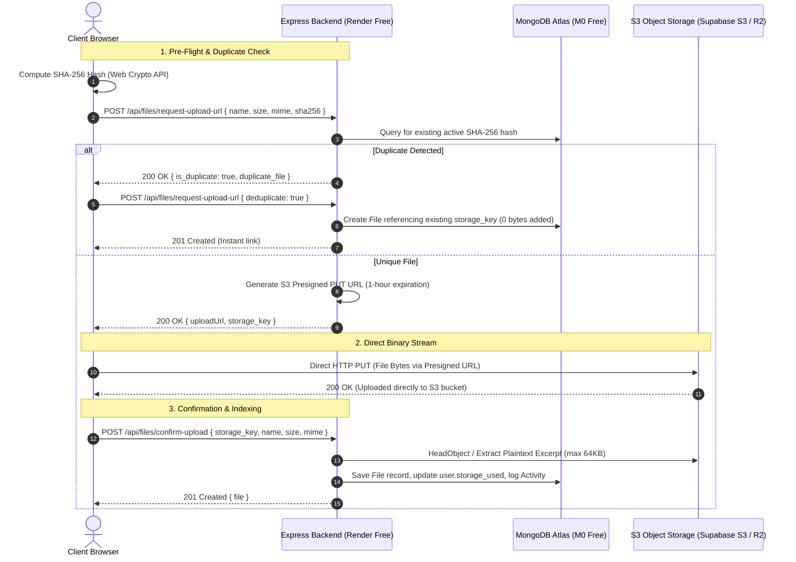

# CloudVault (xenoDrive) ☁️🔒

> **Enterprise-Grade Cloud Storage & Secure File Collaboration Platform**  
> Built with React 19, Tailwind CSS, Node.js, Express, MongoDB Atlas, and S3-Compatible Cloud Object Storage (Supabase S3 / Cloudflare R2).  
> 100% Free-Tier Architecture ($0/month) with direct client-to-storage presigned uploads, client-side SHA-256 deduplication, file versioning, and end-to-end audit logging.

**🌐 Live Demo:** [https://xenodrive-swart.vercel.app](https://xenodrive-swart.vercel.app)  
**⚡ Backend API:** [https://cloudvault-backend-kmzh.onrender.com](https://cloudvault-backend-kmzh.onrender.com)

---

## 📑 Table of Contents
- [Architecture & Data Flow](#-architecture--data-flow)
- [Key Features](#-key-features)
- [Tech Stack](#-tech-stack)
- [Free-Tier Production Stack](#-free-tier-production-stack)
- [Directory Structure](#-directory-structure)
- [Local Development Setup](#-local-development-setup)
- [Automated Testing Suite](#-automated-testing-suite)
- [Deployment Guide](#-deployment-guide)
- [API Documentation](#-api-documentation)
- [Security & Best Practices](#-security--best-practices)

---

## 🏗 Architecture & Data Flow

CloudVault utilizes a modern decoupled cloud architecture where **heavy file binaries never touch the backend application server**, eliminating backend RAM exhaustion, bandwidth saturation, and temporary filesystem data loss.



---

## 🚀 Key Features

### 1. Direct Presigned Object Storage
- **Direct Browser-to-Storage Uploads:** Streams files directly from client to S3-compatible cloud object storage (Supabase S3 / Cloudflare R2) via presigned PUT URLs generated using the AWS SDK for JavaScript v3.
- **Zero Backend Bandwidth Bottleneck:** The backend server handles lightweight JSON metadata operations only.
- **Reference-Counted Object Deletion:** Physical cloud storage objects are safely retained when deduplicated copies exist and only pruned when the last reference is permanently deleted.

### 2. Client-Side SHA-256 Duplicate Detection
- **Web Crypto Hashing:** Computes SHA-256 hashes client-side using chunked streaming before uploading bytes.
- **Pre-Flight Notification:** Flags identical files before upload, allowing users to cancel or link.
- **Zero-Storage Deduplication:** Links the new filename and folder context to the existing storage key with **0 bytes added** to the user's storage quota.
- **Duplicate Scanner:** Interactive modal scans, groups duplicate clusters, and enables one-click storage cleanup.

### 3. Comprehensive File & Folder Management
- **Hierarchical Nested Folders:** Unlimited folder nesting with breadcrumbs navigation and path indexing.
- **Batch Drag & Drop Uploads:** Upload multiple files simultaneously with individual progress tracking and error recovery.
- **Move, Rename, Download, Preview:** Inline media previews (images, audio, video, PDFs) and attachment download generation.
- **Two-Stage Deletion (Trash & Restore):** Soft delete to trash with cascading folder restores and permanent purge.

### 4. Secure Sharing & Access Control
- **Unique Shareable URLs:** Generate public access links for files or folders (`/s/:token`).
- **Read-Only vs Download Permissions:** Fine-grained enforcement preventing downloads on view-only links.
- **Password-Protected Links:** Bcrypt-hashed password challenges for sensitive content.
- **Expiring Links:** Time-limited links with automatic expiration (HTTP 410 Gone).
- **Instant Revocation:** One-click revocation to immediately terminate external access.

### 5. File Version History
- **Multi-Version Uploads:** Upload updated revisions to existing files without losing prior versions.
- **Version Restoration:** Restore previous iterations at any time with complete audit trails.
- **Version Pruning:** Delete stale versions to reclaim allocated quota.

### 6. Storage Analytics & Live Audit Logs
- **Visual Storage Meter:** Real-time capacity breakdown against the quota limit.
- **File Type Distribution:** Dynamic category breakdown (Documents, Images, Videos, Audio, Archives).
- **7-Day Ingestion Trend:** Visual activity bar chart representing daily uploaded bytes.
- **Top Largest Files:** Quick-access list identifying top storage consumers.
- **Live Audit Trail:** Chronological log of uploads, downloads, moves, shares, versions, and deletes.

### 7. Search & Plaintext Document Indexing
- **Multi-Field Filtering:** Search by filename, file category, folder scope (Current vs All Folders), and upload date range.
- **Extracted Document Content Search:** Genuine plaintext extraction from `.txt`, `.md`, `.csv`, `.json`, `.js`, etc., indexed in MongoDB with `matched_in_content` indicators. Zero paid APIs or external dependencies.

---

## 🛠 Tech Stack

| Layer | Technologies |
| :--- | :--- |
| **Frontend** | React 19, Vite, Tailwind CSS v4, Lucide React, React Router v7, React Hot Toast, Axios |
| **Backend** | Node.js (v20+), Express.js, Helmet, CORS, Express Rate Limit, Cookie Parser, Winston |
| **Database** | MongoDB Atlas (M0 Free Tier), Mongoose ODM |
| **Storage** | S3-Compatible Cloud Storage (Supabase S3 / Cloudflare R2), `@aws-sdk/client-s3`, `@aws-sdk/s3-request-presigner` |
| **Authentication** | JWT (JSON Web Tokens), Bcrypt.js (12 salt rounds), HTTP-Only Cookies (SameSite=None, Secure=true) |

---

## 💰 Free-Tier Production Stack

| Service | Provider | Free Allowance | Cost |
| :--- | :--- | :--- | :--- |
| **Frontend Hosting** | Vercel Hobby | Unlimited bandwidth, 100 GB-hours edge execution | **$0.00** |
| **Backend API** | Render Free | 512 MB RAM, 0.1 CPU, 750 free instance hours/month | **$0.00** |
| **Database** | MongoDB Atlas M0 | 512 MB shared RAM/storage, 500 connections | **$0.00** |
| **Object Storage** | Supabase Storage / Cloudflare R2 | S3-compatible API, 1 GB to 10 GB free storage, $0 egress | **$0.00** |
| **DNS & SSL** | Cloudflare / Vercel | Free universal SSL/TLS certificates | **$0.00** |

---

## 📂 Directory Structure

```text
xenodrive/
├── render.yaml                    # Render Infrastructure-as-Code Blueprint
├── vercel.json                    # Root Vercel SPA routing configuration
├── .gitignore                     # Root gitignore preventing secret leakage
├── README.md                      # Complete system documentation
├── DEPLOYMENT.md                  # Step-by-step production deployment guide
├── API_DOCUMENTATION.md           # REST API specification
│
├── backend/                       # Express & Node.js API Service
│   ├── config/                    # Environment, Database, & S3/CORS configurations
│   ├── controllers/               # Route controllers (Auth, Files, Folders, Shares, etc.)
│   ├── middleware/                # Auth guards, Rate limiters, Error & Request loggers
│   ├── models/                    # Mongoose schemas (User, File, Folder, Share, Version, Log)
│   ├── routes/                    # Express API route modules
│   ├── scripts/                   # Database & CORS maintenance scripts
│   ├── services/                  # S3 Object Storage & Health services
│   ├── utils/                     # JWT tokens, AppError, ApiResponse, Activity logger
│   ├── validators/                # Request validation schemas
│   ├── .env.example               # Backend environment variables template
│   ├── server.js                  # Application entry point
│   ├── package.json               # Backend dependencies & npm scripts
│   └── test-*.js                  # Automated test suites
│
└── client/                        # React 19 Frontend Application
    ├── public/                    # Static assets & SVG icons
    ├── src/
    │   ├── assets/                # Design assets & format helpers
    │   ├── components/
    │   │   ├── drive/             # FileCard & FolderCard components
    │   │   ├── layout/            # DashboardLayout, Sidebar, Navbar
    │   │   ├── modals/            # Share, Preview, Version, Duplicate modals
    │   │   └── ui/                # Button, Spinner, ProgressBar, ConfirmDialog
    │   ├── config/                # Axios instance & API client
    │   ├── context/               # Global AppContext & Auth provider
    │   ├── pages/                 # Dashboard, Drive, Login, Trash, Shared views
    │   ├── App.jsx                # Main React router
    │   └── main.jsx               # React DOM entry point
    ├── vercel.json                # Vercel SPA rewrite & security headers
    ├── .env.example               # Frontend environment template
    ├── package.json               # Frontend dependencies & Vite scripts
    └── vite.config.js             # Vite build configuration
```

---

## 💻 Local Development Setup

### Prerequisites
- Node.js (v20.x or higher)
- MongoDB installed locally OR free MongoDB Atlas connection string
- S3-compatible storage credentials (Supabase S3 or Cloudflare R2)
- npm / pnpm

### 1. Clone Repository
```bash
git clone https://github.com/Ayaan-Khan7/xenodrive.git
cd xenodrive
```

### 2. Configure Backend
```bash
cd backend
cp .env.example .env
# Edit .env with your MongoDB URI and S3 storage keys
npm install
npm run dev
# Backend starts on http://localhost:5000
```

### 3. Configure Frontend
```bash
cd ../client
cp .env.example .env
# Verify VITE_BASE_URL=http://localhost:5000
npm install
npm run dev
# Frontend starts on http://localhost:5173
```

---

## 🧪 Automated Testing Suite

CloudVault includes 6 comprehensive automated test suites covering 100% of the core backend functionality:

```bash
cd backend
npm test
```

### Test Coverage
- `test-server.js`: Server startup, centralized error handler, rate limiter, verbose health check.
- `test-auth.js`: JWT issuance, bcrypt hashing, cookie handling, password reset, protected routes.
- `test-drive.js`: Folder nesting, moving, breadcrumb traversal, file upload, download, and soft delete.
- `test-dashboard.js`: Ingestion trend calculation, largest files sorting, category distribution.
- `test-sharing-versions.js`: Public links, password protection, expiration, revocation, multi-versioning.
- `test-advanced-features.js`: SHA-256 deduplication, duplicate scanner API, plaintext content search.
- `test-comprehensive-qa.js`: 40-point full security, storage quota enforcement, and boundary tests.

---

## 🚢 Deployment Guide

For full production deployment instructions on Vercel, Render, MongoDB Atlas, and Supabase S3 / Cloudflare R2, see [DEPLOYMENT.md](DEPLOYMENT.md).

---

## 📖 API Documentation

For the complete REST API specification including parameters, status codes, and sample payloads, see [API_DOCUMENTATION.md](API_DOCUMENTATION.md).

---

## 🔒 Security & Best Practices

- **Zero Secret Exposure:** All credentials are kept in environment variables; `.gitignore` strictly rejects `.env` files across root, frontend, and backend.
- **Cross-User Isolation:** Every database query enforces `{ owner_id: req.user._id }` or active share validation, guaranteeing zero data leakage between accounts.
- **Direct Streaming to S3 Object Storage:** The application server never stores client file binaries on temporary disk.
- **SameSite=None & Secure Cookies:** Strict HTTPS-only cross-origin session cookies for decoupled production domains.
- **Rate Limiting & Helmet:** Global API request rate limiting with Helmet security headers (HSTS, CSP, Frameguard).
